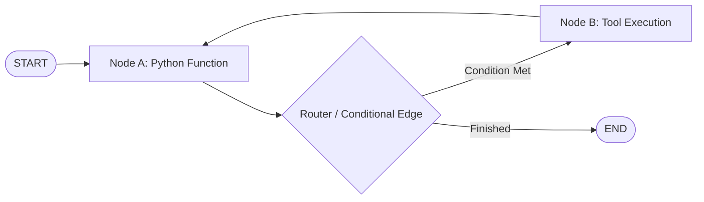
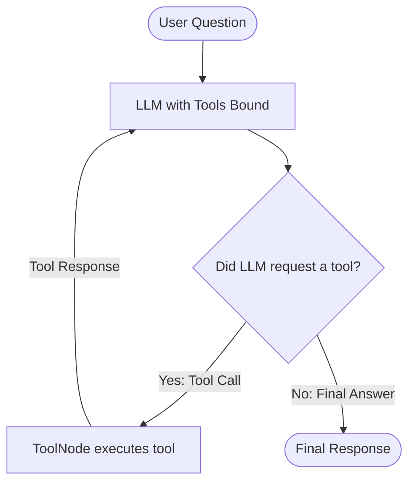
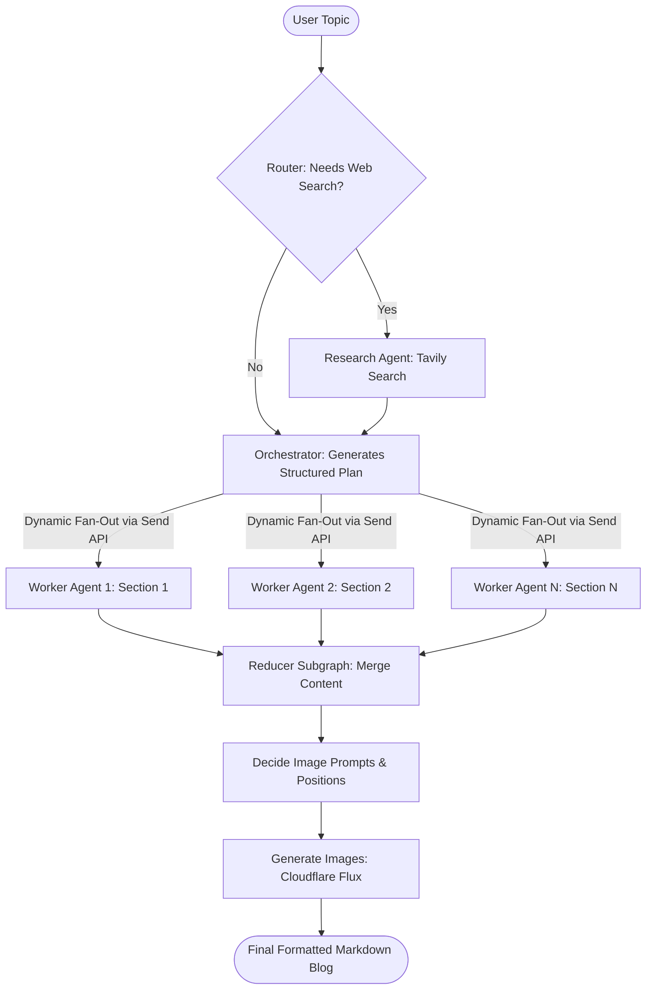

# 🧠 Agentic AI & LangGraph Study Notes

> **Welcome!** These notes break down the core concepts, patterns, terms, and mental models implemented across the 18 modules and capstone project in this repository.  
> The explanations are intentionally **simple, intuitive, and practical**—avoiding unnecessary academic jargon while giving you deep clarity on how modern AI agents actually work.

---

## 📑 Table of Contents

1. [What is Agentic AI? (The Big Picture)](#1-what-is-agentic-ai-the-big-picture)
2. [LangGraph Fundamentals: State, Nodes, and Edges](#2-langgraph-fundamentals-state-nodes-and-edges)
3. [Workflow Patterns in LangGraph](#3-workflow-patterns-in-langgraph)
4. [State Persistence & Checkpointers](#4-state-persistence--checkpointers)
5. [Tool Calling & Agent Decision Making](#5-tool-calling--agent-decision-making)
6. [Model Context Protocol (MCP) Demystified](#6-model-context-protocol-mcp-demystified)
7. [Observability & Tracing with LangSmith](#7-observability--tracing-with-langsmith)
8. [Human-in-the-Loop (HITL)](#8-human-in-the-loop-hitl)
9. [Subgraphs & Modular Architecture](#9-subgraphs--modular-architecture)
10. [LLM Memory Systems (Short-Term vs. Long-Term)](#10-llm-memory-systems-short-term-vs-long-term)
11. [Retrieval-Augmented Generation (RAG) Evolution](#11-retrieval-augmented-generation-rag-evolution)
    - [Naive RAG](#naive-rag)
    - [Corrective RAG (CRAG)](#corrective-rag-crag)
    - [Self-Reflective RAG (Self-RAG)](#self-reflective-rag-self-rag)
12. [Multi-Agent Systems: Orchestrator-Worker & Map-Reduce](#12-multi-agent-systems-orchestrator-worker--map-reduce)
13. [Key LangGraph API Cheat Sheet](#13-key-langgraph-api-cheat-sheet)

---

## 1. What is Agentic AI? (The Big Picture)

### The Evolution:
```
1. Simple Prompting  ──►  You send a prompt, LLM sends a single completion. No memory, no tools.
2. Linear Chains     ──►  Prompt A output feeds into Prompt B (LangChain classic). Rigid pipeline.
3. Autonomous Agents ──►  LLM acts as a reasoning engine in a feedback loop. It decides what to do next.
```

### Traditional Chatbot vs. Agentic AI:
| Feature | Traditional LLM / Chatbot | Agentic AI System |
|---|---|---|
| **Control Flow** | Fixed: Input $\rightarrow$ LLM $\rightarrow$ Output | Dynamic: Decides whether to use tools, retry, or ask for help |
| **Actions** | Generates text only | Interacts with APIs, databases, files, and web search |
| **Loops & Iteration** | None (Single forward pass) | Can evaluate its own output and iterate until satisfied |
| **State** | Stateless or naive chat history | Rich, structured, persistent state across complex tasks |

---

## 2. LangGraph Fundamentals: State, Nodes, and Edges

LangGraph models an agent as a **directed state machine (graph)**. It provides three primary building blocks:



### 1. State (The Shared Memory)
The `State` is a central data structure (usually a Python `TypedDict` or `Pydantic` model) passed between nodes. Every node reads from the state and returns updates to it.
- **Reducers:** Functions that determine how new data combines with old data.
  - By default, returning a key **overwrites** its previous value: `state["query"] = "new query"`.
  - Using `Annotated[list, operator.add]` tells LangGraph to **append** items instead of overwriting.
  - Using `MessagesState` automatically appends chat messages and handles message IDs.

### 2. Nodes (The Workers)
Nodes are standard Python functions that receive the current state, perform an action (call an LLM, run a calculation, query a DB), and return a dictionary of state updates.

```python
def research_node(state: AgentState):
    query = state["topic"]
    results = search_web(query)
    return {"research_data": results}  # Updates state
```

### 3. Edges (The Pathways)
Edges define how the graph transitions from one node to another:
- **Normal Edge (`graph.add_edge("node_a", "node_b")`):** Unconditional transition.
- **Conditional Edge (`graph.add_conditional_edges("router", condition_func, routing_map)`):** Directs traffic dynamically based on state or LLM output.
- **Cycles (Loops):** LangGraph natively supports loops (`Node B` $\rightarrow$ `Node A`), enabling revision, self-correction, and tool retries.

---

## 3. Workflow Patterns in LangGraph

In `01_langgraph_tutorials`, we explore the four classic workflow topologies:

### 1. Sequential Workflow
Step 1 runs, then Step 2, then Step 3.  
*Example:* `Prompt Chaining`—first generate an outline, then generate paragraphs, then proofread.

### 2. Parallel Workflow (Fan-Out / Fan-In)
A single node triggers multiple independent nodes to execute at the same time, merging their results later.  
*Example:* Analyze batting stats and bowling stats concurrently, then combine them for an overall player summary.

### 3. Conditional Workflow (Branching)
The output of a node determines which branch executes next.  
*Example:* Review an incoming message; if sentiment is positive, route to `ThankYouNode`; if negative, route to `EscalateNode`.

### 4. Iterative Workflow (Loops & Feedback)
A node evaluates the draft. If it does not meet quality standards or constraints, it loops back to the generator with constructive feedback.  
*Example:* Tweet Generator that loops until the character count is $\le 280$ and tone matches guidelines.

---

## 4. State Persistence & Checkpointers

LLMs and web applications are stateless by default. To make an agent remember conversations across requests or recover from server restarts, LangGraph uses **Checkpointers**.

### How Checkpointing Works:
1. Every time a node finishes execution, the checkpointer takes a "snapshot" of the full state.
2. Each conversation is assigned a unique `thread_id` (e.g., `{"configurable": {"thread_id": "user_123"}}`).
3. When the user sends a new message, LangGraph loads the latest state for that `thread_id` and continues.

### Checkpointer Flavors Used in This Repo:
- **`MemorySaver` (`InMemorySaver`):** Keeps state in RAM. Great for unit tests and local experimentation. Lost when process exits.
- **`SqliteSaver`:** Stores snapshots in a local SQLite file (`.db`). Lightweight, zero-config, persistent across restarts.
- **`PostgresSaver`:** Production-grade persistence backed by PostgreSQL with connection pooling (`psycopg_pool`). Used in the Capstone Blog Agent.

---

## 5. Tool Calling & Agent Decision Making

Agents become powerful when they can interact with the outside world through **Tools**.



### The Tool-Calling Loop:
1. **Binding:** Tools are defined using Python functions or `@tool` decorators, and bound to the LLM via `llm.bind_tools([tool_a, tool_b])`.
2. **Reasoning:** When prompted, the LLM decides whether it can answer directly or needs external information. If it needs info, it outputs structured JSON specifying the tool name and arguments.
3. **Execution (`ToolNode`):** LangGraph's prebuilt `ToolNode` reads the tool call, executes the underlying Python function safely, and appends a `ToolMessage` with the result to the conversation.
4. **`tools_condition`:** A built-in conditional edge that routes to `ToolNode` if the last message contains tool calls, or routes to `END` if the LLM provided a final answer.

---

## 6. Model Context Protocol (MCP) Demystified

### The Problem MCP Solves:
Before MCP, every AI platform wrote custom integrations for every service: Google Drive, Slack, Postgres, GitHub, Calculator. If you had $N$ models and $M$ services, you needed $N \times M$ custom integrations.

### The Solution:
**Model Context Protocol (MCP)** is an open standard (initiated by Anthropic) that acts like **USB-C for AI applications**.

```
[ Your LangGraph Agent ] (MCP Client)
           │
           │  (Standardized JSON-RPC Protocol over Stdio or HTTP/SSE)
           ▼
[ MCP Server: Arithmetic / SQLite / Weather / Git ]
```

- **MCP Server:** A lightweight program exposing specific tools, resources (files/data), or prompts. In this repo, `07_langgraph_mcp_server` uses **FastMCP** to expose math functions.
- **MCP Client:** The application (LangGraph agent) that connects to MCP servers, discovers their tools dynamically, and executes them without knowing the implementation details.

---

## 7. Observability & Tracing with LangSmith

Agentic workflows involve multiple hops, retries, and tool calls. When something goes wrong or takes 15 seconds, you cannot debug with simple `print()` statements.

**LangSmith** provides full execution visibility:
- **Traces:** The complete end-to-end journey of a single user request.
- **Spans / Runs:** Individual units of work (e.g., a specific prompt, an embedding lookup, a tool call).
- **Latency & Token Metrics:** Exact token usage and cost per node.
- **`@traceable` Decorator:** Lets you trace any arbitrary Python function and send inputs, outputs, and metadata directly to your LangSmith dashboard.

---

## 8. Human-in-the-Loop (HITL)

Fully autonomous agents can be dangerous when performing high-stakes actions (sending an email, deleting database records, executing financial transactions).

### How LangGraph Handles HITL:
1. **Breakpoints (`interrupt_before` or `interrupt_after` / `interrupt()`):** LangGraph pauses graph execution right before a sensitive node runs.
2. **State Inspection:** The human reviews the state, proposed actions, or draft output.
3. **Approval or Modification:**
   - The human can approve the run as-is.
   - The human can edit the state (e.g., fix a generated email text) using `graph.update_state()`.
4. **Resume:** The graph resumes execution with the approved or modified state.

---

## 9. Subgraphs & Modular Architecture

As systems grow, putting 50 nodes in a single flat graph becomes messy and unmaintainable.

**Subgraphs** allow you to treat an entire graph as an individual node inside a parent graph:
- **Encapsulation:** The subgraph has its own isolated state and internal logic.
- **Reusability:** A specialized subgraph (e.g., an Image Processing Pipeline or Content Reducer) can be tested independently and plugged into different systems.
- **Shared vs. Isolated State:** Subgraphs can map outputs back to the parent state cleanly using explicit transformation keys.

---

## 10. LLM Memory Systems (Short-Term vs. Long-Term)

Memory is what separates a one-shot query from an ongoing assistant.

```
                  ┌───────────────────────────────┐
                  │       LLM Memory Systems      │
                  └───────────────┬───────────────┘
                                  │
          ┌───────────────────────┴───────────────────────┐
          ▼                                               ▼
┌───────────────────────────┐                   ┌───────────────────────────┐
│     Short-Term Memory     │                   │     Long-Term Memory      │
│  (Session / Thread Level) │                   │ (Cross-Session / User)    │
├───────────────────────────┤                   ├───────────────────────────┤
│ • In-conversation state   │                   │ • User profile & preferences│
│ • Window trimming         │                   │ • Cross-thread facts      │
│ • Message deletion        │                   │ • Key-value / Vector Store│
│ • Summarization nodes     │                   │ • Namespaced storage      │
└───────────────────────────┘                   └───────────────────────────┘
```

### Short-Term Memory Techniques:
1. **Window Trimming (`trim_messages`):** Keep only the last $N$ messages or tokens so you never exceed the LLM's context window.
2. **Message Deletion (`RemoveMessage`):** Surgically delete intermediate scratchpads, large tool outputs, or sensitive credentials after use.
3. **Summarization:** When message count reaches a threshold, a node calls the LLM to summarize previous turns into a compact paragraph, replacing older messages while keeping key context.

### Long-Term Memory Techniques:
- Uses a persistent store (e.g., `InMemoryStore` or `PostgresStore`).
- Organizes memories using **namespaces** (e.g., `("users", user_id, "profile")`).
- Allows an agent to remember that "Alice prefers concise markdown answers" next week in a completely new thread.

---

## 11. Retrieval-Augmented Generation (RAG) Evolution

This repository traces RAG from naive implementations to production-grade self-correcting pipelines:

### Naive RAG
- **Flow:** User Query $\rightarrow$ Vector Search (FAISS) $\rightarrow$ Stuff Top-$K$ Chunks into Prompt $\rightarrow$ Generate Answer.
- **Flaws:** If the retriever returns irrelevant or noisy chunks, the LLM hallucinates or gives wrong answers. It has no way to detect bad retrieval.

### Corrective RAG (CRAG)
CRAG adds an automated **Retrieval Evaluator**:
1. Retrieve documents from vector store.
2. **Grade Relevance:** A lightweight evaluator grades each document as `relevant` or `irrelevant`.
3. **Fallback to Web Search:** If documents are irrelevant or insufficient, the query is rewritten and routed to Tavily / DuckDuckGo web search.
4. **Refine Context:** Strip irrelevant sentences before sending to the generator.

### Self-Reflective RAG (Self-RAG)
Self-RAG is a self-checking agent loop with reflection tokens:
1. **Retrieve on Demand:** Decides if the question even needs retrieval (e.g., "Hello" does not need RAG).
2. **Grade Retrieval:** Are the retrieved documents relevant to the prompt?
3. **Generate Answer:** Draft answer based on retrieved documents.
4. **Faithfulness Check (Hallucination Evaluator):** Is every fact in the generated answer supported by the documents?
5. **Usefulness Check:** Does the answer actually answer the original user question? If not, rewrite query and loop back.

---

## 12. Multi-Agent Systems: Orchestrator-Worker & Map-Reduce

The capstone project (`project/blog-writing-agent`) implements an **Orchestrator-Worker** pattern using LangGraph's dynamic `Send` API.



### Why This Pattern Shines:
- **Scalability:** Instead of asking one LLM to write a 3,000-word article linearly (which causes quality degradation and timeouts), the Orchestrator breaks it into modular sections.
- **Parallelism (Map):** Multiple sections are written simultaneously by worker agents, dramatically reducing total latency.
- **Specialized Subgraph (Reduce):** The reducer reconciles the sections, checks transitions, generates image prompts, generates AI images via Cloudflare Workers AI (`flux-1-schnell`), and embeds them cleanly.

---

## 13. Key LangGraph API Cheat Sheet

| Class / Function | Purpose | Example |
|---|---|---|
| `StateGraph(StateClass)` | Initializes a graph structure with a typed state. | `builder = StateGraph(MessagesState)` |
| `builder.add_node(name, fn)` | Registers a node in the graph. | `builder.add_node("agent", call_model)` |
| `builder.add_edge(from_node, to_node)` | Connects two nodes unconditionally. | `builder.add_edge("research", "planner")` |
| `builder.add_conditional_edges(src, routing_fn, path_map)` | Routes dynamically based on state. | `builder.add_conditional_edges("agent", should_continue)` |
| `START`, `END` | Special entry and terminal points of the graph. | `builder.add_edge(START, "agent")` |
| `Send(target_node, arg_dict)` | Dynamic fan-out (spawns multiple worker nodes concurrently). | `return [Send("worker", {"task": t}) for t in tasks]` |
| `MessagesState` | Prebuilt state containing a list of `BaseMessage` with append logic. | `class CustomState(MessagesState): ...` |
| `ToolNode(tools)` | Prebuilt node that executes tool calls found in state. | `tool_node = ToolNode([search, calculator])` |
| `tools_condition` | Prebuilt conditional edge checking for tool calls. | `builder.add_conditional_edges("agent", tools_condition)` |
| `graph.compile(checkpointer=...)` | Compiles graph into an executable Runnable with optional state persistence. | `app = builder.compile(checkpointer=SqliteSaver(conn))` |
| `app.stream(inputs, config)` | Streams graph state or tokens chunk-by-chunk. | `for event in app.stream({"messages": [prompt]}, cfg): ...` |
| `app.get_state(config)` | Retrieves the current state snapshot for a given thread ID. | `state = app.get_state({"configurable": {"thread_id": "1"}})` |
| `app.update_state(config, values)` | Manually modifies state for human-in-the-loop interventions. | `app.update_state(config, {"approved": True})` |

---

<p align="center">
  Made with ❤️ by <b>Saksham Agrahari</b> • Star ⭐ this repository if you find it helpful!
</p>

