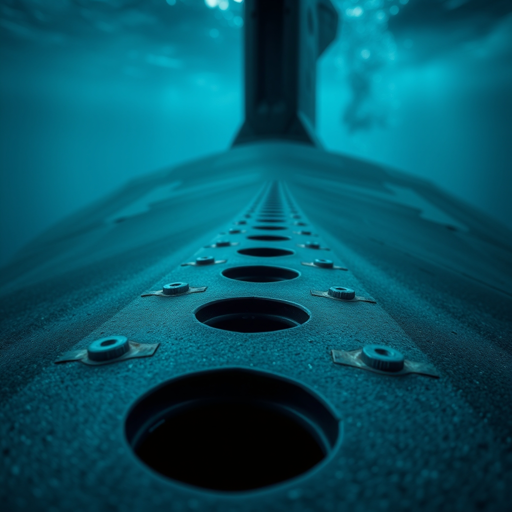
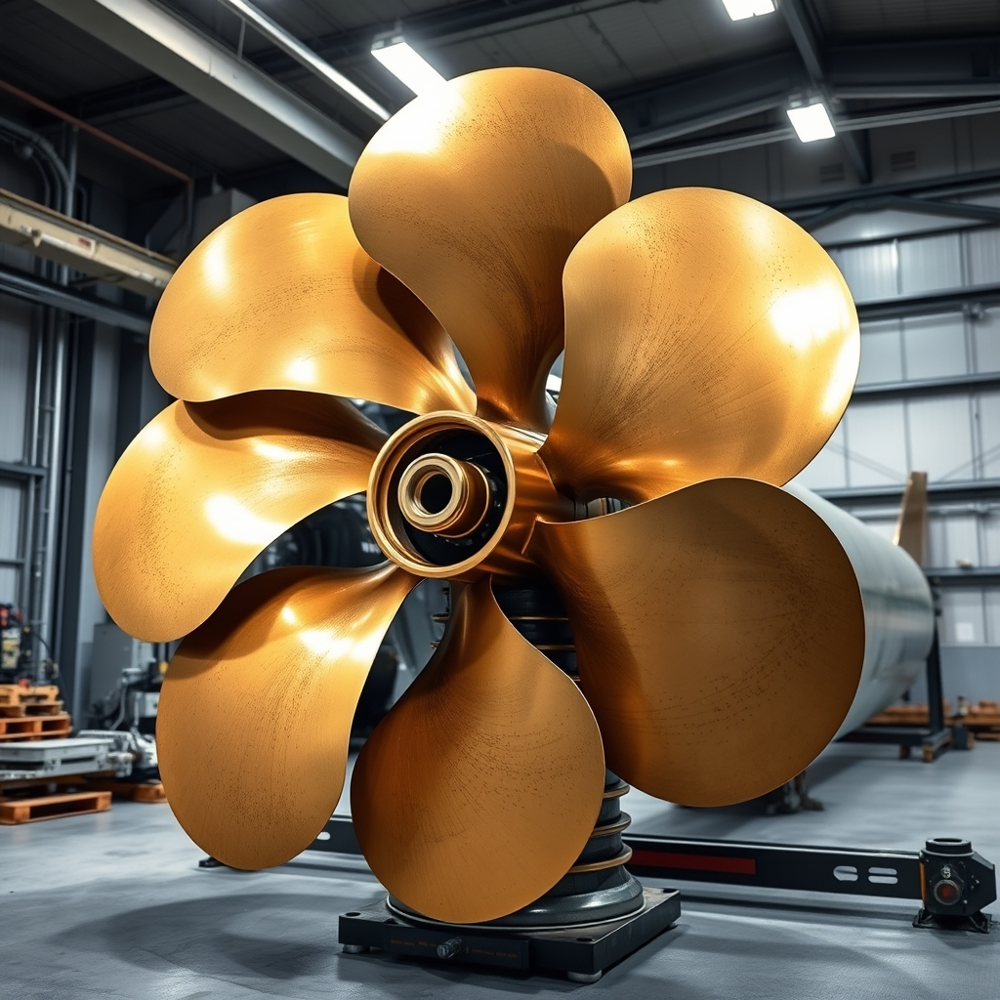
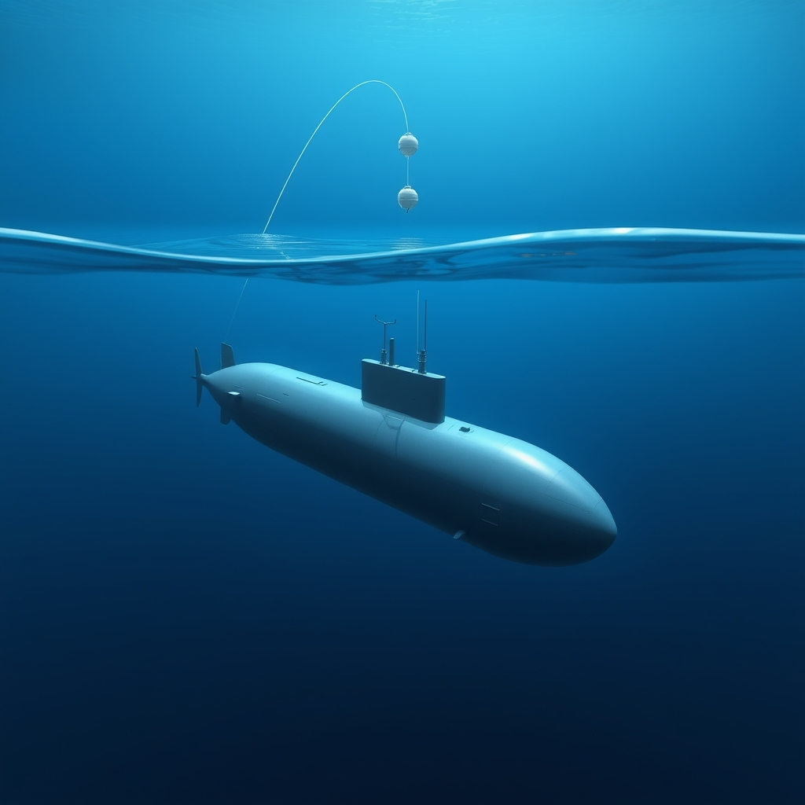

# Engineering the Abyss: How Modern Submarines Operate Deep Underwater

## Hull Architecture and Hydrodynamic Control Systems

Operating at extreme depths requires a delicate balance between materials science, fluid dynamics, and fault-tolerant control systems. As depth increases, hydrostatic pressure scales linearly, imposing massive compressive stresses on the vessel's outer shell.

### Metallurgy and Structural Integrity
Modern submarines rely on high-yield strength structural steels, notably HY-80 and HY-100, alongside advanced titanium alloys for specialized deep-diving architectures. These materials are chosen for their high fracture toughness and yield strength, which prevent catastrophic plastic deformation under multi-axial compressive loads. The pressure hull must sustain uniform stress distributions, minimizing microscopic voids and residual welding stresses that could propagate cracks under cyclic fatigue.

### Hydrodynamic Hull Design
To maximize operational efficiency and stealth, modern hulls utilize an optimized teardrop geometry. This axisymmetric shape minimizes form drag and boundary-layer separation during high-speed transit. A laminar flow profile reduces turbulent wake formation, which not only conserves propulsion energy but also directly suppresses the acoustic signatures exploited by active and passive sonar arrays.

### Actuation and Control Surfaces
Maneuverability across changing water densities and currents is governed by a distributed arrangement of control surfaces:
*   **Stern Planes:** Primary authority over pitch and depth maintenance.
*   **Bow Planes / Sail Planes:** Auxiliary surfaces used for fine-tuning angle-of-attack and periscope-depth transitions.

These surfaces are driven by redundant hydraulic and electromechanical actuators. To eliminate single points of failure, dual-redundant power loops and isolated digital controllers command the hydraulic servo-valves, ensuring continuous actuation under heavy hydrodynamic loads.

### Closed-Loop Stabilization
Maintaining stable pitch and roll at varying underwater speeds requires deterministic, closed-loop feedback systems. Inertial Measurement Units (IMUs) and depth sensors stream high-frequency telemetry into a centralized control computer. Proportional-Integral-Derivative (PID) and modern adaptive controllers compute error states between desired trajectories and actual vessel attitude, automatically modulating control surface deflection angles to counteract hydrodynamic disturbances and shifts in internal ballast.

## Buoyancy Management and Trim Systems

Operating a submarine at depth requires continuous, high-precision control of mass and displacement. According to Archimedes' principle, a submerged hull achieves neutral buoyancy when its total weight exactly equals the displaced volume of seawater. Because seawater density fluctuates with temperature, salinity, and depth, variable ballast systems must dynamically compensate for these environmental shifts to maintain depth without expending excessive energy.

To shift between buoyancy states, automated systems coordinate high-pressure air banks and reversible centrifugal pumps. Main ballast tanks (MBTs) handle gross depth transitions by venting to submerge or utilizing compressed air to blow water out for surfacing. Meanwhile, internal trim and auxiliary tanks fine-tune the longitudinal center of gravity and residual weight differentials. Software controllers regulate variable-speed pump rates and pneumatic valve actuation to transfer ballast fluid with minimal acoustic signature and high volumetric accuracy.

Rapid depth changes introduce severe hydrodynamic and structural risks, requiring hardwired and software-level safety interlocks. These interlocks prevent concurrent sea-chest venting and high-pressure blowing that could over-pressurize structural tanks or induce uncontrolled positive buoyancy surges. Automated venting cut-offs also trigger automatically if hull compression limits or maximum descent rates are breached.

Reliable closed-loop control relies on redundant telemetry sensor arrays. High-resolution quartz crystal pressure transducers measure hydrostatic head to determine precise depth. Concurrently, strain gauges and fiber-optic distributed sensing grids monitor hull compression and hoop stress under extreme hydrostatic loads. These inputs stream directly into the central automation bus, alongside internal atmospheric pressure monitors, ensuring the control loop maintains structural integrity and exact depth equilibrium.

## Closed-Loop Life Support and Atmospheric Monitoring

Sustaining a crew for months underwater requires treating the submarine's interior as a closed-loop cyber-physical life support system. Maintaining a stable, breathable atmosphere demands continuous chemical generation, scrubbing, and multi-variable sensor feedback loops.

* **Electrolytic Oxygen Generation:** Modern vessels deploy electrolytic oxygen generators to split desalinized seawater into hydrogen and oxygen. The system uses proton-exchange membranes or alkaline electrolysis cells, dynamically scaling current density to maintain safe oxygen partial pressures ($pO_2$) between 18% and 21% while venting hydrogen overboard safely.
* **Carbon Dioxide Scrubbing:** To prevent hypercapnia, carbon dioxide must be continuously removed from the ambient air. Submarines utilize amine-based absorption beds that capture $CO_2$ through reversible chemical binding, paired with regenerative thermal swing catalyst systems that desorb the gas for overboard discharge.
* **Trace Gas and VOC Monitoring:** Environmental control units monitor toxic trace gases and volatile organic compounds (VOCs) using real-time mass spectrometry and non-dispersive infrared (NDIR) sensors. These sensors feed continuous telemetry to the central environmental monitoring system, detecting parts-per-million deviations in carbon monoxide, hydrogen, and refrigerants before they threaten crew health.
* **Failure Modes and Emergency Protocols:** In the event of a sudden atmospheric contamination spike or catastrophic power loss, the system immediately isolates internal ventilation zones. Emergency oxygen candles (chemical chlorate generators) and redundant compressed-air banks deploy automatically, while emergency scrubbers shift to passive lithium hydroxide curtains to sustain metabolic viability during grid failures.

## Power Generation and Air-Independent Propulsion (AIP)

Operating deep underwater requires a resilient, high-density power architecture capable of balancing endurance, thermal dissipation, and acoustic stealth. Nuclear submarines rely on pressurized water reactors (PWRs) featuring a closed-loop primary thermal-hydraulic circuit. High-pressure liquid water circulates through the reactor core to absorb fission heat, passing it via steam generators to a secondary loop that drives propulsion turbines. Managing coolant flow rates and preventing boiling crises under varying load profiles demand precise multivariate control systems to regulate pump speeds and control rod positions.

For non-nuclear boats, extended loitering without surfacing relies on air-independent propulsion (AIP) and advanced electrochemistry. Stirling engines use external combustion driven by liquid oxygen and diesel fuel, producing high-torque, low-frequency mechanical energy. In contrast, proton-exchange membrane (PEM) fuel cells combine hydrogen and oxygen electrochemically to generate direct current with minimal acoustic output. While Stirling systems introduce rotating mechanical parts susceptible to mechanical vibration, fuel cells operate silently, shifting the engineering challenge to managing reactant purity and water byproduct expulsion.

Energy storage remains a critical link between generation and dynamic load demands. Modern fleets transition from traditional flooded lead-acid batteries to high-capacity lithium-ion cells. Lithium-ion chemistries provide superior energy density and flat discharge curves under heavy high-current draws, but they introduce severe thermal runaway risks. Subsurface energy management systems must implement rigorous cell-level thermal monitoring, active liquid-cooling plates, and fast-acting circuit breakers to isolate cascading short circuits in confined spaces.

Finally, acoustic signature management governs physical survival. Rotating machinery—including reactor coolant pumps, turbo-generators, and auxiliary cooling fans—generates tonal vibrations that propagate through the hull into the water column. Engineers isolate these noise sources by mounting machinery skids onto resilient, multi-stage elastomeric and pneumatic damping rafts. These active and passive vibration-dampening networks interrupt structure-borne acoustic paths, preventing passive sonar arrays from detecting the vessel at long ranges.

## Navigation in GPS-Denied Environments

Operating at crush depths means absolute reliance on internal metrics because electromagnetic waves cannot penetrate the water column. Modern submarines achieve precision positioning through a layered sensor suite and rigorous algorithmic error-correction.

To maintain drift-minimized inertial navigation, submarines rely on Ring Laser Gyroscopes (RLGs) and Fiber Optic Gyroscopes (FOGs). These optical sensors measure angular velocity using the Sagnac effect, detecting phase shifts in counter-propagating light beams. Because mechanical wear is eliminated, FOGs and RLGs offer high reliability, but raw gyroscope outputs still suffer from bias instability. Engineers continuously calibrate these units using extended Kalman filters (EKFs) to mathematically isolate and subtract systemic drift before it compounds into catastrophic spatial errors.

Because inertial systems inevitably accumulate error over time, velocity inputs must be bounded externally. Engineers integrate Doppler Velocity Logs (DVLs) to measure absolute speed relative to either the ocean floor or the water column. By transmitting acoustic beams downward and measuring the Doppler shift of the backscattered echoes, the DVL provides precise three-axis velocity vectors. 

To bound long-term drift without surfacing, submarines process bathymetric data matches using terrain contour navigation (TCN) algorithms. The hull-mounted sonar maps the sea floor topography in real time, comparing depth profiles against a pre-loaded onboard bathymetric database via particle filtering. 

Below is a minimal Python simulation demonstrating how uncorrected dead-reckoning drift accumulates over time during a submerged transit:

```python
import numpy as np

def simulate_dead_reckoning(steps=100, true_speed=5.0, drift_rate=0.05):
    positions = []
    estimated_pos = np.array([0.0, 0.0])
    
    for t in range(steps):
        # Introduce systematic sensor error accumulation
        current_drift = drift_rate * t
        measured_speed = true_speed + current_drift
        
        # Dead reckoning update step (simplified 1D forward motion)
        estimated_pos[0] += measured_speed
        positions.append(estimated_pos[0])
        
    return positions

drift_log = simulate_dead_reckoning()
print(f"Final accumulated position error: {drift_log[-1] - (5.0 * 100):.2f} meters")
```

By fusing continuous inertial data, DVL velocity bounds, and absolute terrain updates, the integrated navigation system maintains a trustworthy state estimate far beneath the surface.

## Acoustic and Non-Acoustic Stealth Mechanics

Operating undetected in the deep ocean requires rigorous management of both acoustic and non-acoustic signatures. Submarines function as closed-loop cyber-physical systems where mechanical vibration, fluid dynamics, and electromagnetic emissions are continuously monitored and suppressed to avoid detection by hostile sonar and surveillance arrays.



*Anechoic rubber tile coatings applied to the exterior steel hull to absorb active sonar pings and dampen internal acoustic emissions.*

To mitigate active sonar and internal noise propagation, submarine hulls are outfitted with specialized anechoic rubber tile coatings. These composite tiles absorb high-frequency acoustic pings, preventing backscatter, and attenuate internal machinery noise radiating outward from the pressure hull.

Within the hull, internal noise-generating components such as coolant pumps, propulsion turbines, and hydraulic systems are isolated using multi-stage elastomeric and pneumatic mounts. These dampening structures interrupt the mechanical transmission path, preventing structural vibration from coupling directly with the surrounding seawater.



*Advanced skew-back blade geometry designed to smooth out hydrodynamic pressure differentials and delay propeller cavitation.*

Hydrodynamic design is equally critical for suppressing passive acoustic footprints. Flow noise generated by boundary layer turbulence around sail structures and propeller cavitation bubbles can compromise an entire sector. Modern engineering addresses this by utilizing advanced skew-back blade geometries on propellers that smooth out pressure differentials, delaying the onset of vapor-bubble collapse and drastically reducing narrowband acoustic signatures.

Beyond acoustics, submarines must actively manage non-acoustic detection vectors. Thermal wakes created by vertical displacement and propulsion exhaust alter ocean stratification, leaving infrared signatures detectable by advanced satellites. Furthermore, massive ferromagnetic steel hulls distort the Earth's local geomagnetic field, making them vulnerable to Magnetic Anomaly Detection (MAD) sensors. Finally, high-speed operations can agitate marine microorganisms, producing visible bioluminescent wakes that betray a vessel's trajectory in dark littoral waters.

## Submerged Communications and Distributed Command Systems

Operating submerged eliminates standard RF communication channels. Seawater is a dense, conductive medium that rapidly attenuates electromagnetic waves, requiring specialized physical layers and distributed protocols to maintain operational connectivity.



*A tactical floating communications buoy connected via an optical fiber tether, enabling data bursts while the hull remains concealed at depth.*

To receive commands without surfacing, submarines deploy Extremely Low Frequency (ELF) and Very Low Frequency (VLF) radio antennas while maintaining periscope depth. These bands penetrate tens of meters beneath the surface, though their low carrier frequencies severely restrict data rates to a few characters per minute, limiting transmissions to high-priority alerts and trigger codes.

For high-bandwidth transmissions, systems utilize tactical buoys and optical fiber tethers. The submarine can deploy a floating antenna array or release a fiber-optic buoy that communicates via acoustic modems to the hull, establishing a temporary gigabit link for data bursts while keeping the primary vessel concealed at depth.

Because these connections are intermittent, the onboard distributed computing architecture relies on Delay-Tolerant Networking (DTN) protocols. Telemetry and command packages are wrapped in resilient bundle layers that use store-and-forward mechanisms, ensuring data integrity across volatile, drop-prone links until a valid transmission window opens.

When absolute radio silence is mandatory, internal systems communicate externally via acoustic underwater modems. Engineers debugging latency and packet loss in these channels face severe constraints: sound travels through water at roughly 1,500 meters per second, introducing multi-path propagation, severe Doppler shifts, and bandwidth ceilings in the low kilobits per second. Network stacks must dynamically adjust modulation schemes, employing robust error-correcting codes like Turbo codes or LDPC to survive extreme packet drop rates.